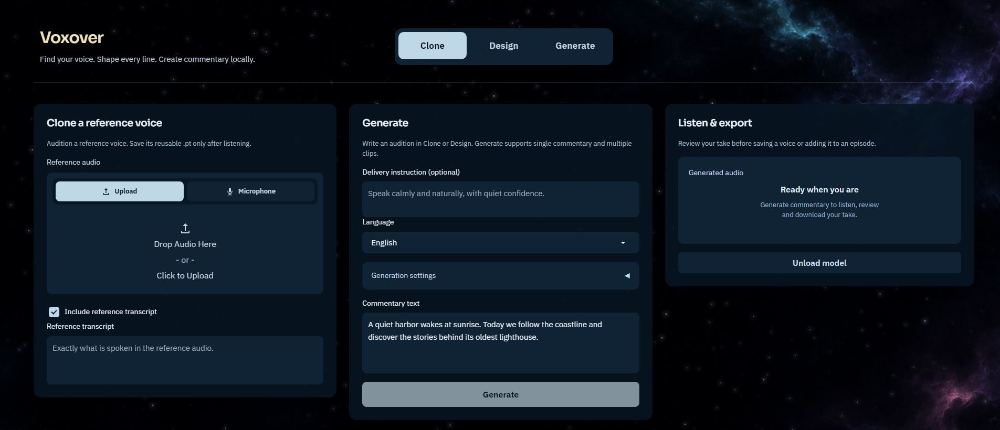
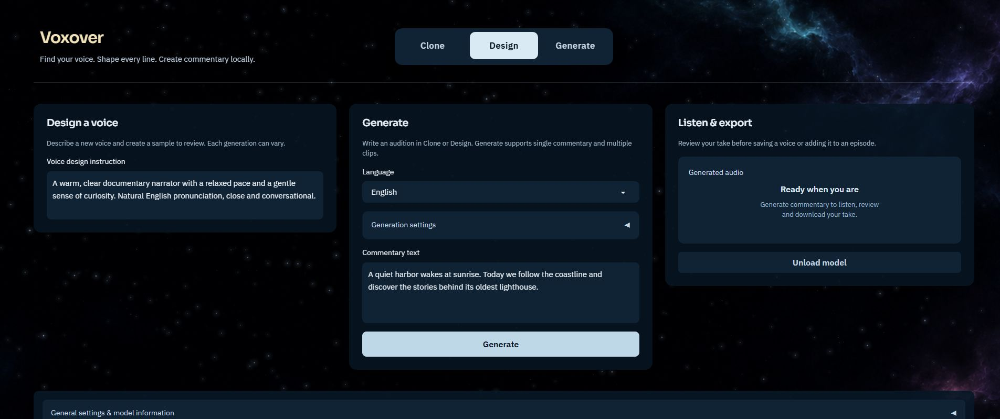
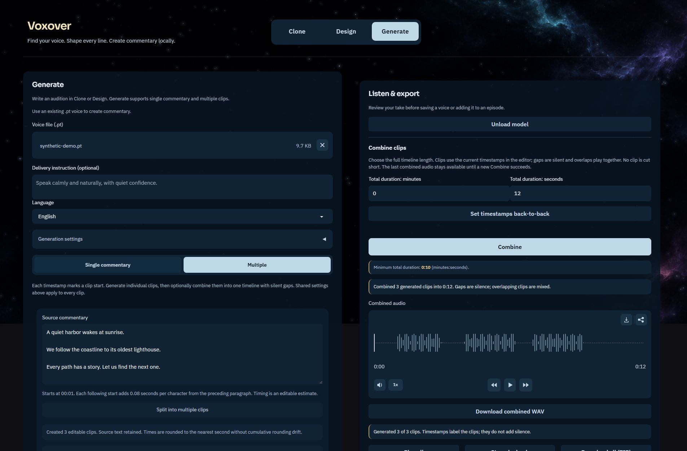
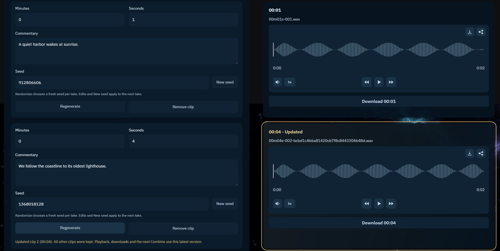

<p align="center">
  
</p>

# Voxover

**Find your voice. Shape every line. Create commentary locally.**

Voxover is a local voiceover workspace built on [Qwen3-TTS](https://github.com/QwenLM/Qwen3-TTS). Clone a reference voice, design a new one in words, audition it, and save a reusable voice prompt. Then create single takes or build a multi-clip commentary timeline with individual regeneration, playback, and WAV export.

This is an independent fork, not an official Qwen release. The speech engine, models, and research are the work of the **Qwen team at Alibaba Cloud**. The custom application lives in [`voxover/`](voxover/); the original engine documentation is preserved in [README.upstream.md](README.upstream.md).

[Get started](#get-started) · [App guide](voxover/README.md) · [Screenshots](#screenshots) · [Verification](#verification) · [Upstream documentation](README.upstream.md)



## Features

### Create a reusable voice

- **Clone:** upload or record reference audio, optionally include its exact transcript, and generate an audition before saving a `.pt` voice prompt. Turning off the transcript uses voice-identity-only conditioning.
- **Design:** describe the voice you want, audition it with the official VoiceDesign model, then explicitly save or download its reusable prompt.
- **Generate:** load a compatible saved `.pt` and create single commentary or multiple clips. Shared commentary, language, and generation settings remain available when switching workflows.
- **Audition first:** listen and download the WAV before saving a voice. Correct the transcript if needed. Clone saves the original reference conditioning; Design and Generate previews are re-encoded with Base when saved as a new voice. No fine-tuning is involved.

### Build and refine commentary

- **Single or Multiple:** write one take, add clip rows manually, or split a plain-text script on blank lines. Imported start times are editable estimates, not speech-duration predictions or subtitle parsing.
- **Generate one row or a whole batch:** first-time row generation works without running the full script. Regenerate an existing take after confirming replacement, leaving other clips intact.
- **Keep working during generation:** edit future drafts and queue other rows. Per-row jobs run sequentially with visible status; only the active row's text/seed and conflicting actions are protected.
- **Seed control:** use a shared seed, editable per-clip overrides, Randomize, and New seed for a future take. Queued jobs retain the seed captured when requested.
- **Paired editor and players:** each paragraph stays aligned with its audio on wide screens and stacks with it on narrow screens. Audio whose paragraph was removed or replaced stays available under Previous clips.
- **Listen and export:** play individual clips or Play all in visible order, stop playback, download separate WAVs, or export a ZIP with a portable manifest. Per-row generation preserves playback and respects explicit Pause/Stop.

### Assemble a timeline

- **Set timestamps back-to-back:** after confirmation, keep the first start and calculate later starts from the actual generated WAV lengths, including fractional seconds.
- **Combine:** place clips at their current timestamps in a PCM-24 WAV of your chosen total duration. Gaps and trailing space are silent; overlaps are mixed. There is no automatic stretching, resampling, or truncation.
- **Clear duration guidance:** see the minimum total length before combining. Too-short exports are rejected. If overlaps would clip, a disclosed whole-track gain reduction protects the output.
- **Keep the last good result:** edits, regeneration, or a failed Combine do not remove the previous combined WAV. Press Combine again when you want a new snapshot.

### Local workstation controls

- Ten named languages plus Auto, optional experimental Base delivery instructions, and advanced sampling settings with a reset button.
- Lazy model loading, a minimum-free-VRAM check, optional release after generation, explicit Unload model, and serialized model operations within each app instance.
- Persistent local output/voice folder selection, companion generation-settings JSON files, and inline Gradio API and Settings sections.
- A dark animated night-sky theme, reduced-motion support, readable loading/error states, and numeric fields protected against accidental mouse-wheel changes.
- Windows launcher and a local shortcut helper with a bundled multi-resolution icon.

## Screenshots

These are genuine captures of the current UI, not design mockups. They use an isolated local session with fictional text and a synthetic, non-personal voice fixture. The output waveforms are synthetic test tones, **not examples of model quality**. No personal recordings or model weights are included. See [capture details](docs/screenshots/README.md).

### Design a voice in words



### Import, generate, and combine multiple clips



### Refine individual takes



## Get started

### 1. Prepare a Python environment

Use **Python 3.12** in a separate environment and install a CUDA-enabled PyTorch build appropriate for your NVIDIA GPU using the [official PyTorch instructions](https://pytorch.org/get-started/locally/). Then install the engine and pinned UI dependencies:

```sh
git clone https://github.com/AWADREE/Voxover.git
cd Voxover
python -m pip install -e .
python -m pip install -r voxover/requirements.txt
```

The current frontend **requires NVIDIA CUDA** and at least **6 GiB free GPU memory** before loading a model. It uses `cuda:0` and bfloat16; there is no CPU or Apple MPS fallback in this app. Longer text and references may need more memory. See the [tested compatibility baseline](voxover/README.md#requirements-and-installation) and [upstream environment guidance](README.upstream.md#environment-setup). A fresh cross-platform installation is not claimed to be qualified.

### 2. Cache the models

Download [Qwen3-TTS-12Hz-1.7B-Base](https://huggingface.co/Qwen/Qwen3-TTS-12Hz-1.7B-Base) separately, following the [upstream model download instructions](README.upstream.md#released-models-description-and-download). Add [Qwen3-TTS-12Hz-1.7B-VoiceDesign](https://huggingface.co/Qwen/Qwen3-TTS-12Hz-1.7B-VoiceDesign) for Design mode. Saving a designed audition as a `.pt` also needs Base.

The app uses local model files only and **does not download weights on startup**. It expects the standard Hugging Face cache layout with `refs/main` and `snapshots/<revision>/`, not a plain folder of weights.

| Variable | Purpose |
| --- | --- |
| `HF_HOME` | Hugging Face root, normally `~/.cache/huggingface`; model caches live under its `hub/` folder. |
| `VOXOVER_MODEL_CACHE` | Optional Base cache override, pointing to the model directory containing `refs/` and `snapshots/`. |
| `VOXOVER_DESIGN_MODEL_CACHE` | Optional VoiceDesign cache override. By default it is beside the Base cache. |
| `VOXOVER_PORT` | Local server port, default `8003`. |
| `VOXOVER_PYTHON` | Python executable used by the Windows launcher. |

Nonempty `VOXOVER_*` values take priority, followed by legacy `CADENTVOX_*`, then `VOICE_STUDIO_*`. The app directory is `voxover/`; the engine package remains `qwen-tts`. When upgrading an older checkout, move your ignored Outputs, Voices, Temp and local configuration from the former app directory into `voxover/` before launching. External model caches are unchanged.

### 3. Launch

```sh
cd voxover
python -B app.py
```

Open **http://127.0.0.1:8003**. On Windows, run `voxover/Open-GUI.ps1` from the repository root to start the app and open your browser. Set `VOXOVER_PYTHON` to the Python executable in your environment if needed. `voxover/Create-Shortcut.ps1` creates a Voxover shortcut beside the app and in the current user Start menu.

### 4. Make your first take

1. Choose **Clone** and provide a reference you have permission to use, or choose **Design** and describe a voice.
2. Enter **Commentary text**, select a language, and click **Generate**.
3. Listen. Optionally correct the transcript, then select **Save audition as voice .pt**. Saving is explicit, not automatic.
4. Choose **Generate**, load the saved `.pt`, and select **Single commentary** or **Multiple**.
5. Generate, refine, and export. The [step-by-step app guide](voxover/README.md#multiple-clips) covers importing scripts, individual takes, queues, seeds, timing, and Combine.

## Limits and responsible use

- **Text:** 1–2,000 characters per take; up to 100 rows in a batch. Long scripts must be split. Plain-text paragraph import does not parse subtitle formats.
- **Timing:** individual WAVs and Play all do not insert timestamp gaps. Only Combine places audio on a timeline. Changed commentary needs a matching new take before alignment or combining.
- **Models:** the custom UI uses 1.7B Base and 1.7B VoiceDesign. Upstream CustomVoice, tokenizer, fine-tuning, and other models are covered in the [original README](README.upstream.md).
- **Delivery instructions:** Base has no supported plain-text instruction parameter. Voxover passes `instruct_ids` through private helpers, so adherence is experimental and upstream changes may break it. Successful synthesis does not prove the direction was followed.
- **Voice prompts:** `.pt` files are conditioning data, not trained models. Re-encoding a preview does not guarantee the same delivery on later text. Use only compatible trusted files and voices you have permission to use; do not clone voices to deceive or impersonate without authorization.

## Files and privacy

Default runtime folders are `voxover/Outputs/`, `voxover/Voices/`, and `voxover/Temp/`. Changing output/voice locations affects future saves without moving old files. These defaults, audio, prompts, settings, and logs are excluded from Git. Review staged files before publishing, especially after choosing custom output locations.

The app binds to localhost, disables public Gradio sharing and Gradio analytics, and loads models offline. This is a local workflow, not a hosted service or a substitute for securing your computer. Model weights and personal voice/audio data are not distributed with the repository.

## Verification

The project includes Python unit/integration tests and JavaScript regression scripts for generation, storage, sample-first saving, per-clip queues/seeds, playback, alignment, timing, Combine, readiness, and UI transitions.

```sh
cd voxover
python -B -m unittest discover -v
```

Run the JavaScript suites with Node.js in PowerShell:

```powershell
Get-ChildItem test_*.cjs | ForEach-Object {
    node $_.FullName
    if ($LASTEXITCODE) { throw "JavaScript test failed: $($_.Name)" }
}
```

Some Python validation tests require the Base model cache. Most synthesis tests use mocks and a non-personal synthetic voice fixture; they do not establish voice quality. Historical real-model and browser checks are documented separately:

- [Sample-first Clone and Design](voxover/SAMPLE-FIRST-VERIFICATION.md)
- [Per-clip generation, regeneration, queues, and alignment](voxover/CLIP-REGENERATION-VERIFICATION.md)
- [Playback continuity and sample-accurate timing](voxover/PLAYBACK-TIMING-VERIFICATION.md)
- [Seed randomizer](voxover/SEED-RANDOMIZER-VERIFICATION.md)
- [Timeline combining](voxover/MULTIPLE-COMBINE-VERIFICATION.md)
- [Original baseline and its limits](voxover/VERIFICATION.md)

This documentation refresh passed **214 Python tests** and all **18 JavaScript scripts**, including 2,121 artwork geometry cases. See [the checks and limitations](docs/screenshots/README.md#validation) for what was verified while preparing these screenshots.

## Keeping up with Qwen

`main` contains Voxover. Integrate official Qwen changes on a separate branch, resolve conflicts, run compatibility and real-generation checks, and only then merge. There is no automatic synchronization. See the [update and rollback workflow](voxover/UPDATING.md).

## Credits and license

- **Qwen team / Alibaba Cloud:** Qwen3-TTS engine, models, research, and original demo. [README.upstream.md](README.upstream.md) retains the original model descriptions, examples, evaluations, and citations.
- **Voxover:** custom frontend, workflows, generated background, and app icon. See [asset provenance](voxover/ASSET-PROVENANCE.md).
- **Sora and IBM Plex Sans:** bundled under SIL Open Font License 1.1, with license texts in [`voxover/assets/`](voxover/assets/).

Code is distributed under [Apache License 2.0](LICENSE). Retain upstream and [third-party notices](voxover/THIRD_PARTY_NOTICES.md) when redistributing. Model downloads have their own model cards and applicable terms. This fork claims no official Qwen affiliation or ownership of its technology.
