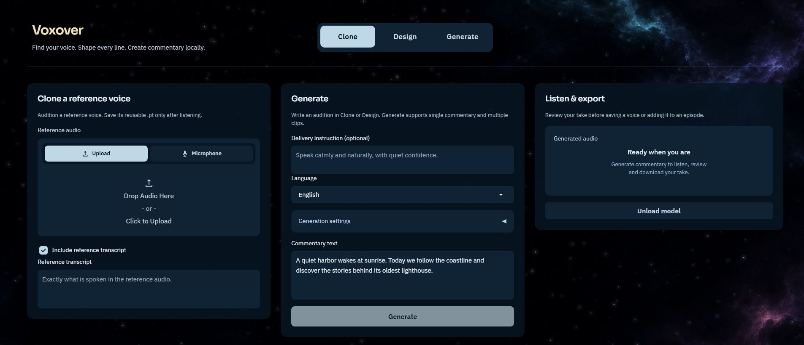
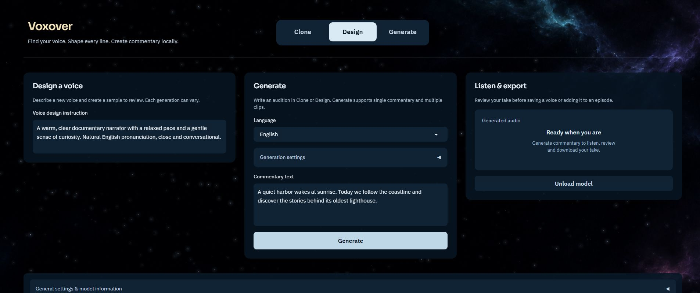
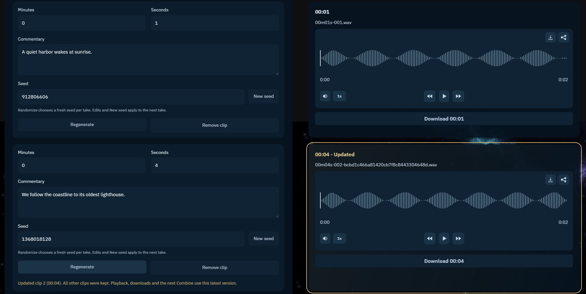
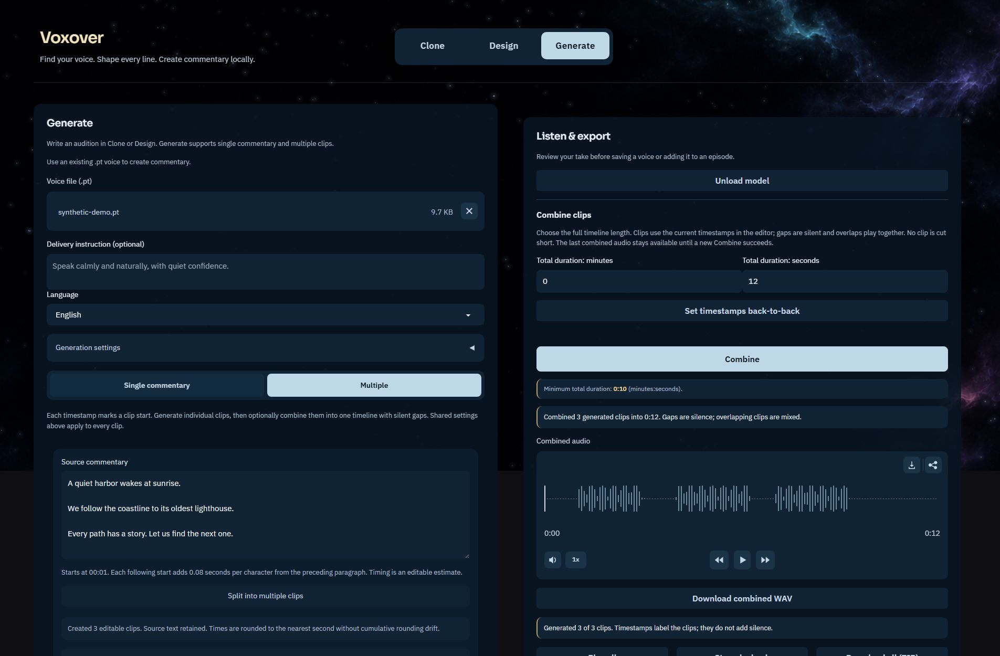

# Voxover app guide

[Project overview](../README.md) · [Screenshots](../README.md#screenshots) · [Upstream Qwen documentation](../README.upstream.md)

Voxover is a local Gradio app for Qwen3-TTS Base and VoiceDesign. It adds an audition-first voice workflow, single and multi-clip commentary, individual takes, timeline combining, and local exports. The underlying engine and research belong to the Qwen team. Screenshots show the actual UI with fictional text and synthetic test-tone audio, not model-quality samples; see [capture details](../docs/screenshots/README.md).

## Requirements and installation

- Python **3.12** is the tested app baseline.
- An **NVIDIA CUDA GPU** is required. The loader uses `cuda:0`, bfloat16, and a **6 GiB free-VRAM** guard. This is a minimum check, not a guarantee against out-of-memory errors. There is no CPU/MPS fallback in this frontend.
- Install a compatible CUDA-enabled PyTorch build with the [official installer guidance](https://pytorch.org/get-started/locally/).
- Cache **Qwen/Qwen3-TTS-12Hz-1.7B-Base**. Also cache **Qwen/Qwen3-TTS-12Hz-1.7B-VoiceDesign** for Design. Base is needed when saving a designed sample as a voice.

From the repository root:

```sh
python -m pip install -e .
python -m pip install -r voice_studio/requirements.txt
cd voice_studio
python -B app.py
```

Open **http://127.0.0.1:8003**. The Windows `Open-GUI.ps1` launcher starts the server if needed, then opens the browser. `Create-Shortcut.ps1` creates a Voxover shortcut beside the app with its bundled icon, without adding a Start menu entry. Launchers are separate from the upstream `qwen-tts-demo` command.

The recorded local compatibility baseline is torch 2.11.0+cu128, qwen-tts 0.1.1, transformers 4.57.3, accelerate 1.12.0, Gradio 6.17.3, NumPy 2.5.4, and SoundFile 0.14.0. The UI requirements pin the last three. Use a separate environment instead of upgrading a working Qwen installation in place. New platforms and fresh installers have not been exhaustively qualified.

### Model cache and configuration

Models are downloaded separately using the [upstream instructions](../README.upstream.md#released-models-description-and-download). Startup does not download weights; model loading is deferred until generation or voice saving.

Expected default layout:

```text
<HF_HOME>/hub/
  models--Qwen--Qwen3-TTS-12Hz-1.7B-Base/
    refs/main
    snapshots/<revision>/config.json
    snapshots/<revision>/...
  models--Qwen--Qwen3-TTS-12Hz-1.7B-VoiceDesign/
    refs/main
    snapshots/<revision>/...
```

`refs/main` contains the snapshot revision. A standalone weights folder created with a different download layout is not equivalent to this cache.

| Variable | Meaning |
| --- | --- |
| `HF_HOME` | Hugging Face root; default `~/.cache/huggingface`. |
| `VOXOVER_MODEL_CACHE` | Direct Base model cache directory containing `refs/` and `snapshots/`. |
| `VOXOVER_DESIGN_MODEL_CACHE` | Direct VoiceDesign cache; by default the sibling of the Base cache. |
| `VOXOVER_PORT` | Server port; default `8003`. |
| `VOXOVER_PYTHON` | Python executable for the Windows launcher. |

For app-specific variables, the first nonempty value wins: `VOXOVER_*`, then `CADENTVOX_*`, then `VOICE_STUDIO_*`. The internal folder name and upstream package name remain `voice_studio` and `qwen-tts` for compatibility.

PowerShell example, with paths replaced by your own:

```powershell
$env:VOXOVER_PYTHON = 'C:\path\to\environment\Scripts\python.exe'
$env:HF_HOME = 'D:\Models\huggingface'
$env:VOXOVER_PORT = '8003'
.\voice_studio\Open-GUI.ps1
```

Run that launcher example from the repository root.

## Clone a reference voice

1. Choose **Clone**.
2. Upload a reference recording or select **Microphone**. Browser microphone access may need your permission. Input format support depends on the installed audio decoders; WAV is a useful starting point.
3. Leave **Include reference transcript** enabled and enter exactly what the recording says, or turn it off for identity-only cloning.
4. Enter the new **Commentary text** to audition. Select the language and optional delivery direction/settings.
5. Click **Generate** and listen in **Listen & export**. Download the WAV if wanted.
6. Use **Save audition as voice .pt** when ready. There is no approval-checkbox step and no automatic `.pt` save. If needed, **Correct transcript before saving** lets you correct the words in the *original reference recording*.

The saved Clone prompt retains the original reference conditioning. It does not re-clone the generated audition. With transcript disabled, it saves voice identity only and does not require a transcript correction.



## Design a voice

1. Choose **Design** and enter a **Voice design instruction**, describing the voice and delivery you want.
2. Write the audition in **Commentary text**, choose its language, and click **Generate**.
3. Listen and optionally correct the sample's actual words.
4. Choose **Save audition as voice .pt**, or use **Download voice** in the Design panel to save the prompt and start its download.

Design uses the official VoiceDesign API and checkpoint. Saving its sample as a reusable voice encodes that audio with Base, so both checkpoints are needed for the complete workflow. A prompt is not a fine-tuned model and may not reproduce exactly the same delivery on different text.



## Generate single commentary

1. Choose **Generate** and upload a compatible **Voice file (.pt)**.
2. Select **Single commentary**, enter 1–2,000 characters, and choose the shared settings.
3. Click **Generate**, listen, and download the WAV. A companion JSON records the generation inputs/settings in the output folder.
4. Optionally save the generated preview as a new voice. This re-encodes the generated audio using Base; correct the sample transcript first if necessary.

An uploaded prompt is not changed. Compatible files contain one Qwen voice item and must be no larger than 100 MiB; not every file with a `.pt` extension is a voice prompt. Use trusted files only.

Switching between Clone, Design, and Generate preserves shared draft text, language, and settings. Clone/Design use the single audition text; Multiple drafts return when you switch back to Generate.

## Multiple clips

### Write or import

Choose **Generate → Multiple** and load a voice. Use **Add clip** to write rows, or paste a script into **Source commentary** and choose **Split into multiple clips**.

```text
A quiet harbor wakes at sunrise.

We follow the coastline to its oldest lighthouse.

Every path has a story. Let us find the next one.
```

Blank lines separate paragraphs. Internal single line breaks are retained. The first estimated start is **00:01**; later starts add **0.08 seconds per preceding paragraph character**, with displayed estimates rounded to whole seconds without cumulative rounding drift. These are editable estimates, not measured speech timing. This importer does not parse SRT, VTT, or embedded timestamp syntax.

Replacing existing nonempty or retimed rows requires confirmation. Cancel keeps the existing rows and **Undo last import** restores the previous draft. Source text is retained. Oversized imports are rejected without replacing existing content.

Limits: **100 rows**, **1–2,000 characters per row**, whole minutes **0–9999**, and seconds **0 ≤ seconds < 60**, including fractional seconds. Duplicate timestamps are allowed.

Manual **Add clip** starts at the preceding row's current timestamp plus five seconds, including minute rollover. The first row still starts at **00:01**. Every row exposes **Seed** and **New seed**; a blank seed inherits the shared seed until overridden.

### Generate and refine

- The main **Generate** button synthesizes the current rows sequentially. The normal top Listen loader stays visible for initial and repeat runs. Each paragraph has its own queued/active loader in the existing audio slot, replaced by its playable clip as soon as it finishes. Full replacement of existing Listen audio asks for confirmation.
- A row's **Generate** button creates only that take, even before a full batch exists. Added rows do not require regenerating the rest.
- A generated row shows **Regenerate**. Confirm **Replace & regenerate** to create a replacement using its current text, voice, and settings. Cancel/Escape does not enqueue or synthesize it.
- Successful replacements update that player, individual download, ZIP, and the source for future Combine operations. **Updated** highlights the replacement. Previous disk files are not overwritten.
- Completed rows can queue a confirmed regeneration while the rest of a full batch is running. Other rows can also queue while an individual take is running. Jobs run in order, after the current full batch finishes. A queued request captures its seed when accepted; its text and shared settings are read when it starts. A removed queued row is canceled.
- Draft editing, Add clip, navigation, and future seed choices remain usable. The active row's text/seed are read-only; conflicting replacement/import actions wait for the queue. Do not mistake an editable future seed for the seed already captured by a queued take.
- Errors appear beside the affected row and retain its previous audio. A failure does not stop later queued jobs. A first full batch stops after a failed clip and retains completed clips; a failed full replacement keeps its newly completed takes and all unreplaced previous takes.

Rows and their players are matched by stable identity. Removing/import-replacing a row does not erase its audio: unmatched players remain under **Previous clips**. After an import, **Undo last import** can restore the previous draft and its audio pairing. Manual removal has no undo control. There is no drag-to-reorder control.



### Seeds and Randomize

Open **Generation settings**:

- **Seed** defaults to `42`; `-1` requests random generation. A fixed seed helps compare takes but does not promise identical output across hardware or dependency changes.
- **Randomize** dims the shared seed and prepares fresh editable seeds for Single commentary and Multiple rows. New/imported rows receive independent seeds.
- **New seed** or a manual per-clip edit prepares the next take. An accepted queued job keeps its captured seed, even if you prepare a future one.
- Turning Randomize off restores shared-seed behavior for Single and rows without overrides. Existing per-clip overrides remain visible and active.
- Seeds must be whole numbers from `-1` through `9007199254740991`. Changing a seed alone does not generate audio or rebuild a combined WAV.

### Playback and downloads

**Play all** starts from the first visible clip each time and plays the visible sequence, without inserting gaps from timestamps. **Stop playback** ends the sequence. Individual players support ordinary playback controls. Per-clip generation preserves ongoing playback; explicit Pause/Stop remains authoritative. Leaving Multiple stops the sequence.

Download a clip's WAV or choose **Download all (ZIP)**. The ZIP contains completed WAVs and `manifest.json` with clip metadata, including captured seeds; it does not include the reusable voice prompt or all delivery settings. Each batch uses its own output directory and timestamp/ordinal filenames, for example `02m15s-003.wav`.

## Timing and Combine

Individual clip timestamps are placement labels until you use **Combine**. They do not force the speech length or add silence to separate files/Play all.

### Set timestamps back-to-back

After all current paragraphs have matching generated audio, choose **Set timestamps back-to-back** above Combine and confirm overwriting timestamps. The first start stays unchanged; subsequent starts use actual WAV frame counts and may contain fractional seconds.

This requires an idle queue and matching generated text/row identities. Missing or stale audio must be generated first. Alignment changes timestamps only: it does not synthesize or combine audio, and it leaves the last combined WAV intact.

### Export a combined timeline

1. Review the current row timestamps, or align them back-to-back.
2. Set **Total duration: minutes/seconds** to the full desired timeline length, not an amount of extra padding. **Minimum total duration** updates from the current audio and positions.
3. Click **Combine**.
4. Listen to **Combined audio** and use **Download combined WAV**.



The exported PCM-24 WAV places sources at their current timestamps. Gaps and trailing space are digital silence; overlaps sum together. Peaks above full scale trigger a disclosed whole-track gain reduction. Sources must have matching sample rate and channel count; no resampling, downmixing, or time stretching occurs.

Total duration starts at the current minimum required length, rounded up to whole seconds, and follows valid clip/timestamp changes until you edit either duration field. Once edited, your value is preserved for the session, including against delayed automatic updates. The minutes and seconds fields have separate spacing.

Total duration uses whole seconds, must be positive, and cannot exceed 24 hours, classic WAV size limits, or available disk space. Too-short requests report overruns and the minimum required length; no clip is truncated. A partial batch can combine available clips with an explicit generated/requested count.

Changed text must be generated again before combining. Timestamp-only changes do not need new speech. Removed or import-replaced generated rows require a new full batch before combining. The **last successful combined WAV is a snapshot**: edits, regeneration, alignment, or failed Combine attempts keep it available. Only a successful Combine replaces the displayed result.

## Shared generation settings

Languages: **Auto, English, Chinese, Japanese, Korean, German, French, Russian, Portuguese, Spanish, Italian**.

| Control | Default / behavior |
| --- | --- |
| Maximum new tokens | `8192`, range 128–32768; a generation cap, not a time target. |
| Temperature / top-k / top-p | `0.9` / `50` / `1.0` for speech sampling. |
| Repetition penalty | `1.05`. |
| Enable speech sampling | On. |
| Subtalker temperature / top-k / top-p | `0.9` / `50` / `1.0` for acoustic sampling. |
| Enable subtalker sampling | On. |
| Reset sampling defaults | Restores the sampling controls. |
| Release GPU memory after generation | On; batch generation releases after the batch. |
| Use voice identity only | Ignores reference delivery for saved-voice generation; may reduce resemblance. |

Temperature controls accept 0.05–2, top-p 0.05–1, repetition penalty 0.5–2, and top-k nonnegative integers. Numeric wheel protection prevents an ordinary scroll from silently changing values; keyboard editing still works.

**Base delivery instructions are experimental.** The supported Base wrapper has no plain-text instruction argument; Voxover tokenizes instructions through private helpers and passes `instruct_ids` to the shared generation path. Listen to judge adherence. Design uses its supported voice-description interface instead.

## Storage, GPU, and utilities

**General settings & model information** displays read-only checkpoint paths and lets you select output and voice folders. Choose absolute local-drive folders, not network shares. Choices persist after restart and affect future saves only; existing files are not moved.

Default folders:

- `Outputs/`: generated WAVs, settings JSON, batch folders/manifests/ZIPs, and combined exports.
- `Voices/`: reusable voice prompts saved by the app.
- `Temp/`: temporary/Gradio files and local verification artifacts.

Runtime files and local settings are excluded from Git. Check custom output folders before committing. Prompts can encode voice identity; never publish someone else's prompt or recording without permission.

**Unload model** affects only this server instance. It does not cancel active generation: while the model is in use, wait and try again. Switching between Base and VoiceDesign releases the previous checkpoint first. Closing a browser tab does not stop its server or free a model loaded by another process.

**Use via API** and **Settings** expose the native Gradio utilities as inline accordions. Inspect the running app's API section for current signatures. The legacy single-generation and saved-voice API contracts remain available; the main UI uses the shared workflow endpoint.

## Troubleshooting

- **Generate is disabled:** check the required voice/reference/description, commentary, transcript checkbox, timestamps, and numeric settings. Full Generate requires valid rows; row generation can handle a valid row independently.
- **Local checkpoint missing/incomplete:** verify `refs/main`, its revision, the snapshot contents, and that the selected cache matches Base or VoiceDesign. Startup will not download missing files.
- **CUDA unavailable / not enough free memory:** use a CUDA-capable environment and free GPU memory in other applications or server processes. Closing their browser tabs is insufficient. More than 6 GiB may be needed.
- **Cannot combine / minimum unavailable:** check changed text, missing takes, replaced rows, total duration, and source format. Re-generate stale content; use a new full batch when row identities were replaced.
- **A saved combined file seems unchanged:** that is intentional retention. Press Combine again after successful edits/regeneration/alignment to make a new result.
- **Voice download is not a model:** use a compatible single-item `.pt` prompt. Model weights and arbitrary PyTorch checkpoints cannot be loaded as voice files.

## Tests and verification

From this directory, with the Base model cached and Node.js installed:

```sh
python -B -m unittest discover -v
```

```powershell
Get-ChildItem test_*.cjs | ForEach-Object {
    node $_.FullName
    if ($LASTEXITCODE) { throw "JavaScript test failed: $($_.Name)" }
}
```

The documentation refresh passed **214 Python tests** and **18 JavaScript scripts**, including 2,121 artwork geometry cases. Python was run with `NUMBA_DISABLE_JIT=1`; model inference was mocked. The [screenshot validation record](../docs/screenshots/README.md#validation) distinguishes that run from historical real-model checks.

See [initial verification](VERIFICATION.md), [sample-first workflow](SAMPLE-FIRST-VERIFICATION.md), [clip/queue/alignment checks](CLIP-REGENERATION-VERIFICATION.md), [playback and timing](PLAYBACK-TIMING-VERIFICATION.md), [Randomize](SEED-RANDOMIZER-VERIFICATION.md), and [Combine](MULTIPLE-COMBINE-VERIFICATION.md). Earlier verification files are chronological records; later behavior notes supersede older descriptions. These checks establish execution and wiring, not subjective voice quality or exhaustive microphone/download compatibility.

## Upstream, theme, and licensing

Use [UPDATING.md](UPDATING.md) for the separate-branch update/rollback process. The custom UI depends on its tested Gradio version and private Base instruction helpers.

The included night-sky artwork, animated stars, fonts, and app icon are portable assets. Reduced-motion preferences are respected. See [asset provenance](ASSET-PROVENANCE.md), [third-party notices](THIRD_PARTY_NOTICES.md), and the [Apache 2.0 license](../LICENSE). Model cards have their own terms. For upstream CustomVoice, tokenizer, fine-tuning, and Python API documentation, use [README.upstream.md](../README.upstream.md).
